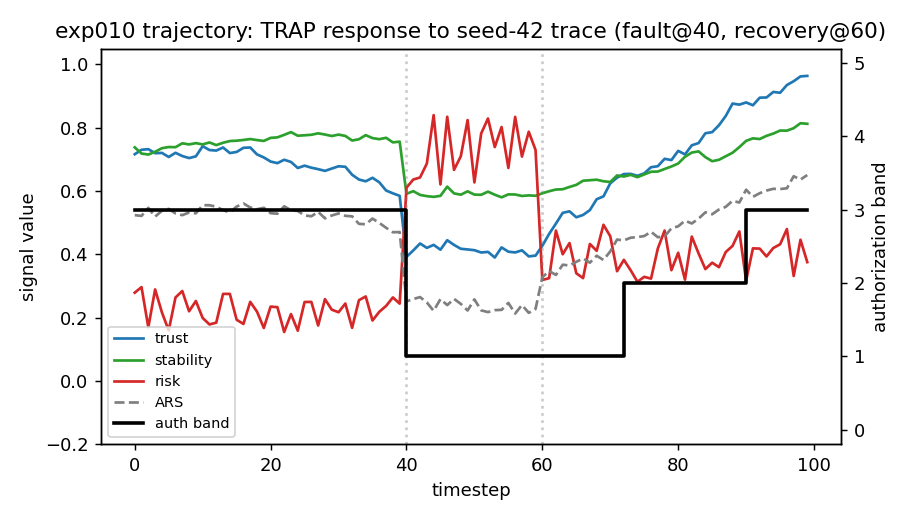
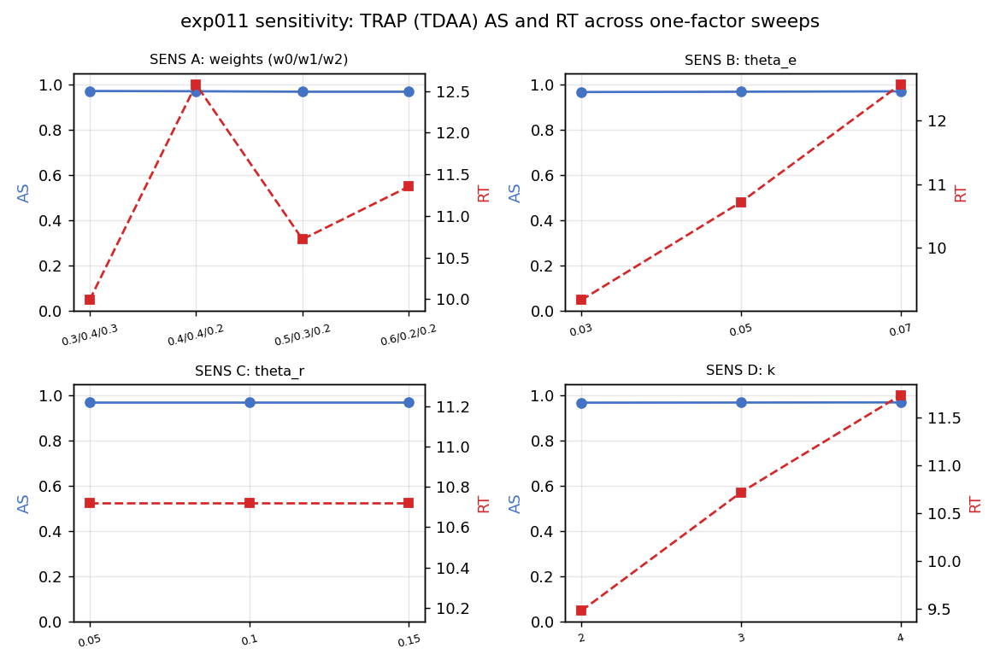
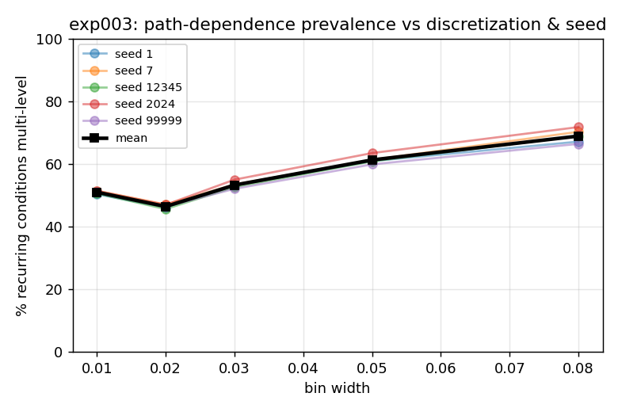

# TRAP — Trust-Responsive Runtime Authorization Policy

**Reproducibility artifact for:**
*Trust-Responsive Runtime Authorization for Agentic AI with Empirical
Characterization of Policy Behavior and Parameter Sensitivity*

Ahsan Habib Shihab\* (Al-Farabi Kazakh National University) ·
Štefan Gubo, Ladislav Végh, Imre Gábor Felde (J. Selye University) ·
Amir Mosavi (Obuda University; J. Selye University)
<br><sub>\* Corresponding author</sub>

## Overview

The Trust-Responsive Authorization Policy (TRAP) maps an Authorization Readiness
Score (ARS), a weighted combination of runtime trust, operational stability and
contextual risk, onto discrete authorization levels through an asymmetric rule:
escalation requires a run of consecutive observations that reach a band edge
plus a margin, while a sufficiently sharp drop in readiness restricts authority
at once. On identical Monte Carlo traces with scripted degradation and recovery,
the paper compares TRAP with static, trust-only, risk-only and symmetric
policies, and sweeps its parameters one factor at a time. A further experiment
(exp012) spreads the same degradation over several intervals and measures how
long each policy holds more authority than readiness supports.

**This repository reproduces** every table and figure of the paper from the
frozen artifact (tag `trap-v1-frozen`): the policy behavior comparison
(Table III), the sensitivity sweeps (Table V), Figures 1–3, and the structural
statistics of Section VI-E. Stored results are re-derived and compared
byte-for-byte, and all files are checked against SHA-256 manifests. Two
analyses added after the freeze, the interval estimates (Table IV) and the
gradual-degradation experiment exp012 (Table VI), live outside `frozen/` and
are separately reproducible.

## Key results

Policy behavior on the same 100 seed-42 traces for every policy (Table III; *n* = 100, seed 42,
*w* = (0.5, 0.3, 0.2), θ<sub>e</sub> = 0.05, θ<sub>r</sub> = 0.10, *k* = 3).
AS is mean ± SD; n/a denotes a metric undefined on every trace; for PER and
PRR, lower is better.

| Policy | AS | RR | RT | PER | PRR |
|---|:-:|:-:|:-:|:-:|:-:|
| Static | 1.0000 ± 0.0000 | n/a | n/a | n/a | n/a |
| Trust-only | 0.9673 ± 0.0100 | 0.00 | 15.13 | 0.0096 | 0.5053 |
| Risk-only | 0.9385 ± 0.0148 | 0.00 | 2.28 | 0.2405 | 0.7950 |
| Symmetric | 0.9646 ± 0.0104 | 2.00 | 17.14 | 0.0000 | 0.4798 |
| **TRAP** | **0.9699 ± 0.0064** | **0.00** | **10.72** | **0.0000** | 0.5550 |

<sub>AS: Authorization Stability · RR: Restriction Responsiveness ·
RT: Recovery Time · PER: Protective Efficiency Ratio ·
PRR: Progressive Recovery Ratio (defined in the paper).</sub>

### Gradual degradation (exp012, added after the freeze)

The same total degradation, applied at once (the frozen generator) or spread
linearly over *L* intervals, on the same 100 traces. EAD: mean number of the 20
degradation intervals in which a policy's level exceeds the level its current
readiness maps to (lower is better), over all 100 traces in every column; the
*L* = 5 column therefore includes the 4 traces that violate the gradual
condition. In parentheses: traces on which the policy lowers its level during
degradation (Table VI).

| Policy | Abrupt | *L* = 5 | *L* = 10 | *L* = 20 |
|---|:-:|:-:|:-:|:-:|
| Static | 19.85 (0) | 19.05 (0) | 17.89 (0) | 15.41 (0) |
| Trust-only | 17.24 (99) | 19.82 (7) | 19.96 (0) | 19.86 (0) |
| Risk-only | 4.41 (100) | 7.46 (100) | 10.49 (100) | 15.28 (100) |
| Symmetric | 9.79 (98) | 10.12 (98) | 10.28 (98) | 9.85 (97) |
| **TRAP** | **0.81** (100) | 18.92 (4) | 18.15 (0) | 15.89 (0) |
| Traces violating the gradual condition | 100 | 4 | 0 | 0 |

TRAP restricts on a sharp drop in readiness, so its advantage holds for abrupt
degradation only; under the ramps it lowers its level only on the 4 traces
whose readiness still drops by more than θ<sub>r</sub> in one interval. On the
other 96 traces at *L* = 5, which meet the gradual condition, TRAP never lowers
its level and its EAD is 19.17 [18.75, 19.46] against 10.14 for the symmetric
policy (paired difference +9.03 [+7.96, +10.06], never negative). For *L* = 10
and *L* = 20 every trace meets the condition. The design, metric definitions
and analysis plan are in
[`postfreeze/exp012_gradual_degradation/PROTOCOL.md`](postfreeze/exp012_gradual_degradation/PROTOCOL.md),
fixed before the experiment was run.

The trust-only and risk-only rows need a different reading. These policies apply
the band edges to their own signals, *T* and 1 − *R*, which lie above the ARS.
They already exceed the ARS-mapped level in 34.2 and 39.8 of the 40 intervals
before degradation begins, so their EAD mixes this offset with restriction
delay. Measured against their own mapped signals, their abrupt-case EAD is 1.65
and 0.90. Restriction behavior is therefore compared among static, symmetric
and TRAP. These figures come from `results/offset_diagnostic.csv`, a diagnostic
that is not part of the protocol and was added after the results were seen.

## Figures

<p align="center">
  
</p>

**Figure 1. TRAP response trajectory.** TRAP response over the first of the 100
seed-42 traces: trust, stability, risk and ARS (left axis) with the authorization
level (right axis). Dotted lines mark degradation (*t* = 40) and recovery onset
(*t* = 60).

<p align="center">
  
</p>

**Figure 2. Parameter sensitivity.** AS (left axes) and RT (right axes) across
the four one-factor sweeps.

<p align="center">
  
</p>

**Figure 3. Multi-level condition recurrence.** Share of recurring conditions
observed at two or more authorization levels against bin width, per seed and
averaged.

<sub>The images in `assets/` are byte-identical copies of the frozen figures
listed in the mapping below.</sub>

## Experiments

From Table II of the paper. The behavioral contribution rests on exp010 and
exp011; exp003–exp009 were committed by the companion study and are drawn on as
supporting evidence.

| ID | Role | Scale |
|---|---|---|
| exp003 | Multi-level condition prevalence | 5×5 settings, 4000 ep. each |
| exp004 | Admissibility envelope | 20,000 episodes |
| exp005 | Generator verification (pilot) | 264 histories |
| exp006 | Pilot path-dependence (null result) | 50 targets |
| exp007 | Reachable memory enumeration | BFS, 500 score bins |
| exp008 | Generator verification (final) | 200 histories |
| exp009 | Primary path-dependence measurement | 50 targets × 2 seeds |
| exp010 | Policy behavior comparison | 5 policies × 100 runs |
| exp011 | Parameter sensitivity | 13 sweep points |
| exp012 | Gradual degradation (post-freeze) | 4 profiles × 5 policies × 100 traces |

exp003–exp011 live in `frozen/experiments/<id>_*/` with their metadata, runners
and stored results. exp012 was added after the freeze and lives in
`postfreeze/exp012_gradual_degradation/`.

## Reproduce

Python 3.12. No GPU, network access or external data are needed.

```bash
pip install -r requirements.txt
python scripts/run_all_checks.py            # integrity, harness, exp010-exp012, intervals (under a minute)
python scripts/run_all_checks.py --exp003   # additionally regenerate exp003 (about 6 minutes)
```

<details>
<summary>Individual steps</summary>

```bash
python scripts/check_behavioral.py      # Tables III and V, Figs. 1-2 data
python analysis/confidence_intervals.py --check  # interval estimates, Table IV (omit --check to rewrite output)
python postfreeze/exp012_gradual_degradation/run.py    # exp012: writes results/
python postfreeze/exp012_gradual_degradation/check.py  # exp012: regenerates and compares, Table VI
python scripts/regenerate_exp003.py     # Sec. VI-D values, Fig. 3
cd frozen
python reproduce_all.py                 # Sec. IV / VI-E statistics (31 checks)
python verify_all_frozen.py             # exp003-exp009 digests and file sets
python verify_trap_frozen.py            # exp010-exp011 digests and file sets
python verify_exp005_frozen.py
python verify_exp008_frozen.py
```

On a Windows console, set `PYTHONIOENCODING=utf-8` before running
`reproduce_all.py` directly; `run_all_checks.py` sets it automatically.
</details>

Stored results are compared byte-for-byte. Figure images are also regenerated,
but only their underlying data files are required to match exactly.

The interval estimates and exp012 were added after the freeze, and neither
changes `frozen/`. `analysis/confidence_intervals.py` first checks that the
per-run records reproduce every stored aggregate exactly, and then computes 95%
percentile bootstrap intervals (10,000 resamples, one fixed seed for every
interval), including paired differences on the shared traces. The exp012 checker
first confirms that its generator with *L* = 1 reproduces the frozen generator
bit for bit and that its abrupt control reproduces all 500 stored exp010 per-run
records, then regenerates every stored exp012 result and compares it exactly.
Both outputs are deterministic.

## Paper ↔ Artifact

Paths below are relative to `frozen/experiments/` unless shown in full.

| Paper element | Files | Reproduced by |
|---|---|---|
| Table III / Sec. VI-A | `exp010_trap_baseline/raw_results.csv`, `processed_results.csv` | `scripts/check_behavioral.py` |
| Table V / Sec. VI-B | `exp011_trap_sensitivity/sweep_*.csv` | `scripts/check_behavioral.py` |
| Table IV and interval estimates in Sec. VI-A, VI-B | `exp010_trap_baseline/raw_results.csv`; exp011 per-run records regenerated from the frozen code | `analysis/confidence_intervals.py` (output in `analysis/output/`) |
| Table VI / Sec. VI-C | `postfreeze/exp012_gradual_degradation/results/` | `postfreeze/exp012_gradual_degradation/check.py` |
| Figure 1 | `exp010_trap_baseline/figures/trajectory.png`, `trajectory_figure_data.csv` | `scripts/check_behavioral.py` (data) |
| Figure 2 | `exp011_trap_sensitivity/figures/sensitivity.png`, `sensitivity_figure_data.csv` | `scripts/check_behavioral.py` (data) |
| Figure 3 / Sec. VI-D | `exp003_robustness/figures/pct_multi_vs_binwidth.png`, `raw_results.csv`, `processed_results.csv` | `scripts/regenerate_exp003.py` |
| Sec. VI-E structural statistics | exp004–exp009, `frozen/pdi.py`, `frozen/generator*.py` | `frozen/reproduce_all.py` |
| Algorithm 1 / Sec. III | `frozen/policies.py`, `frozen/sim.py`, `frozen/variants.py` | digest-verified (`MANIFEST.sha256`) |
| Sec. IX (integrity) | `frozen/index/`, `frozen/verify_*.py` | `scripts/run_all_checks.py` |

The structural results of Sections IV and VI-E are those of the companion study
(A. H. Shihab, A. Mussa and M. Mansurova, "When Identical Conditions Yield
Different Authority: Measuring Path-Dependence in Trust-to-Authorization
Policies", MIWAI 2026, to appear in Springer LNAI), which shares this frozen
artifact.

## Repository structure

```
README.md, LICENSE            this file; MIT License
requirements.txt               pinned environment
assets/                        copies of Figures 1-3 for this page
scripts/                       run_all_checks.py, check_behavioral.py, regenerate_exp003.py
analysis/                      confidence_intervals.py and its output (added after the freeze)
postfreeze/exp012_*/           exp012 protocol, code, results and checker (added after the freeze)
frozen/                        the frozen artifact (tag trap-v1-frozen)
  sim.py, policies.py, variants.py        simulator and policies
  pdi.py, generator.py, generator_v2.py   path-dependence instruments
  reproduce_all.py, verify_*.py           reproduction harness and verifiers
  index/                                  SHA-256 manifests and digests
  experiments/exp003 ... exp011           runners, stored results, figures
```

## Provenance

`frozen/` is the file tree of tag `trap-v1-frozen`, commit
`ede109c1d392e26788c1980611d825c07387f2c4`, with four internal
project-management files removed. None of the removed files is covered by a
manifest or used by any script here. Every remaining file is byte-identical to
that commit; `frozen/index/MANIFEST.sha256` (73 files) and
`frozen/index/trap_manifest.sha256` (28 files) record their digests.

<details>
<summary>Notes</summary>

- `frozen/README.md` and `frozen/requirements.txt` are the original package
  files, kept unchanged because they are covered by the integrity manifest. The
  per-experiment commands in `frozen/README.md` for exp003–exp009 assume the
  original working directory `/tmp/tdaa`, which those runners hard-code; use the
  scripts above instead. `frozen/requirements.txt` omits the plotting library;
  the root `requirements.txt` is complete.
- The runners for exp004–exp009 are included as the record of how those results
  were produced. Their results are regenerated here through `reproduce_all.py`
  rather than by re-running those runners.
</details>

## Licence

Released under the [MIT License](LICENSE).
